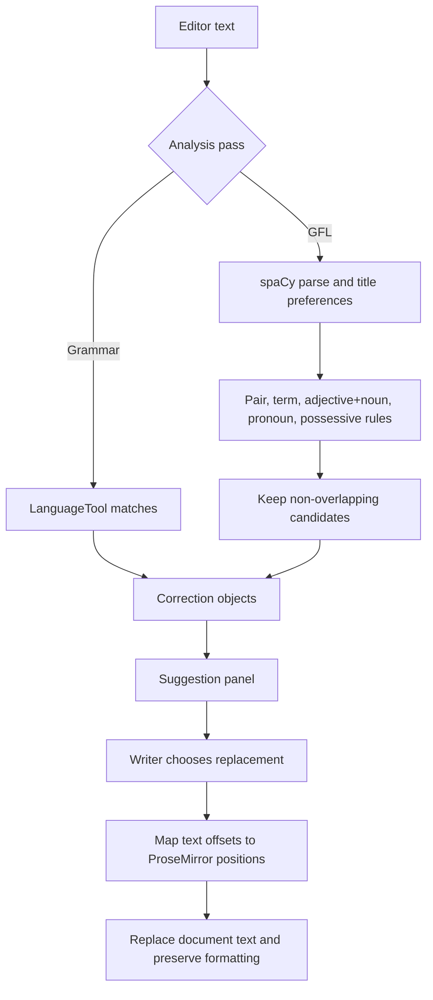

# Inkclusive algorithm and function guide

This guide follows a document from editor input through analysis and back to an applied edit. It also describes the backend support functions and the key frontend conversion functions. Generated UI primitives, Svelte lifecycle callbacks, and declarative store definitions are not algorithms; their roles are summarized at the end.

## 1. Main analysis flow

The application has two independent analysis passes. The grammar pass delegates to LanguageTool. The gender-fair language (GFL) pass combines fixed phrase rules, a configurable term list, and pronoun rules. Neither pass automatically edits the document: each returns candidate corrections with character offsets. The writer chooses which correction to apply.

The GFL result's `revised_text` is a preview formed by taking the first alternative for every surviving correction. The editor still uses the separate correction list for interactive edits. Applying a correction uses its original-text offsets, so offsets must match the text sent for analysis.

## 2. Gender-fair checker (`inkclusive-backend/main_gfl.py`)

### Data and setup

- `DEFAULT_PRONOUNS` maps each category (`male`, `female`, `gender_fair`) to subject, object, possessive, and reflexive forms.
- `GENDER_ADJECTIVES` contains gendered modifiers used by the adjective+noun rule.
- `GENDER_PAIRS` maps paired gendered nouns or pronouns to candidate neutral expressions.
- `nlp = spacy.load('en_core_web_sm')` loads the English pipeline once when the module starts. spaCy supplies token boundaries, parts of speech, dependency roles, and named entities; it does not decide whether a phrase is socially appropriate.

### `GenderFairLanguage` methods

| Function | Purpose and algorithm |
|---|---|
| `__init__(terms_csv)` | Stores the CSV path; loads term alternatives and JSON guidance metadata; records file modification times so later requests can detect admin edits. |
| `_get_source_signature()` | Returns modification times (or `None`) for the term CSV and companion metadata JSON. |
| `refresh_terms_if_changed()` | Compares current file times with the saved signature. If either changed, reloads alternatives and metadata, then updates the signature. |
| `_load_and_prioritize_terms(csv_filename)` | Reads each CSV row as a term plus alternatives, lowercases terms, drops empty terms/options, and orders terms by descending word count. Longer phrases have priority during detection. |
| `_adjust_capitalization(original, replacement)` | Keeps a replacement's explicit capitalization if it has uppercase characters; otherwise mirrors all-uppercase, title case, or lowercase from the original. |
| `_is_within_quotes(doc, start_idx, end_idx)` | Counts unescaped double quotes on both sides of a span. Treats it as quoted only when both boundaries are inside a paired quote. Several detectors skip such text. |
| `_process_text_replacements(text, name_pronoun_map)` | Parses text once with spaCy. Detects honorifics (`Mr`, `Ms`, `Mrs`, `Mx`, `Sir`, `Madam`) followed by proper-name tokens and adds inferred categories to the preference map. Runs each rule detector, resolves overlaps, attaches metadata, then applies the first replacement of each correction from right to left so earlier offsets stay valid. Returns preview text and correction records. |
| `_normalize_hyphenated_name(name)` | Removes spaces around hyphens and trims a name, allowing variants such as `Ada-Lovelace` to match consistently. |
| `_get_pronoun_role(token)` | Uses spaCy dependency tags / `PRP$` to choose subject, object, possessive, or reflexive form. Defaults to subject when the parse has no recognized role. |
| `_find_gender_pairs(text, doc)` | Searches case-insensitively for each configured pair in either order, allowing simple `s`/`es` endings and `and`/`or`. For `or`, attempts to singularize plural alternatives. Skips quoted matches, preserves capitalization, and returns span-based suggestions. |
| `_find_adjective_noun_pairs(text, doc)` | Scans adjacent spaCy tokens. If a token is in `GENDER_ADJECTIVES` and the next token is a noun, proposes alternatives for the noun from the term library (or the noun itself if no term exists). The full adjective+noun span is highlighted; quoted spans are skipped. |
| `_find_individual_terms(text, doc)` | For each prioritized library term, performs a case-insensitive whole-word/whole-phrase regex search. Removes alternatives identical to the matched text, skips quoted matches, adjusts case, and emits offsets and alternatives. |
| `_find_pronoun_replacements(text, doc, name_pronoun_map)` | For a gender-marked pronoun token (`PRP`/`PRP$`), skips neutral pronouns and quoted spans. Searches up to 10 preceding tokens for a mapped proper name, then falls back to prior PERSON/ORG entities. Uses that category's pronouns when found; otherwise uses singular-they forms. Keeps case and emits a one-word correction. |
| `_find_possessive_constructions(text, doc)` | For a token in `GENDER_ADJECTIVES`, checks for a possessive `'s` dependency child. If found, suggests deleting the possessive phrase and following space, unless quoted. |
| `_filter_overlapping_corrections(corrections)` | Sorts by start offset ascending and, for equal starts, longest end first. Greedily keeps a candidate only if its start is at or after the end of the last kept span. This ensures the same characters are not replaced twice. |
| `process_text(text, name_pronoun_map=None)` | Rejects empty/non-string input, runs `_process_text_replacements`, and returns original text, first-option preview, and valid corrections sorted by character offset. |

`load_gfl(csv_path)` is the factory that constructs a `GenderFairLanguage` instance.

### Correction object

Each correction records `original_text`, `replacements`, `character_offset`, and `character_endset` (exclusive end offset). Some rules also include `word_index`. The API adds `message`, `rationale`, `category`, `rule_id`, and examples from the metadata JSON. A term metadata match uses `GFL_TERM_LIBRARY`; otherwise the rule ID is `GFL_LANGUAGE_PATTERN`.

## 3. Grammar analysis and HTTP API (`inkclusive-backend/main.py`)

| Function | Purpose |
|---|---|
| `AnalysisRateLimitMiddleware.dispatch(request, call_next)` | For grammar/GFL POST paths, retains timestamps less than 30 seconds old per client IP. Rejects a request when there are already 10 in the window and returns a `Retry-After`; otherwise records it and forwards the request. |
| `require_admin(credentials)` | Validates a bearer token with `verify_admin_token`; raises HTTP 401 when absent or invalid. Used as a dependency on term mutations/reads. |
| `admin_login(payload, request)` | Requires password and token-secret configuration; checks failed attempts per IP within 15 minutes (limit 5), verifies the password, clears failures on success, and issues an expiring token. |
| `admin_change_password(payload, _admin)` | Requires the bearer dependency, changes credentials, maps invalid current password to HTTP 400 and save failures to 503. |
| `health_check()` | Returns a static service health/version object. |
| `_grammar_revision(body)` | Locks the shared LanguageTool instance, checks the submitted text and makes LanguageTool's corrected preview. Converts each match into bounded start/end offsets, original snippet, message/category/rule ID, and at most five replacement options. Service errors become HTTP 503. |
| `grammar_revision(body)` | Versioned and legacy HTTP wrapper returning `_grammar_revision`. |
| `gender_fair_revision(body)` | Locks term refresh and GFL processing, increments the persistent analysis counter, and returns the counter with checker results. Invalid text maps to 422; analyzer failures map to 503. |
| `list_all_terms_legacy()` / `list_all_terms()` | Under the terms lock, returns the term library in the legacy dictionary shape or current record-list shape. |
| `list_term_records_legacy()` | Compatibility route returning the record-list shape. |
| `get_term_legacy(term)` / `get_term(term)` | Case-insensitive lookup; returns the legacy term/options object or full record, or HTTP 404. |
| `_create_term(term_data)` | Creates one term under lock and reads back its record. Duplicate terms become HTTP 409. `create_term_legacy` and `create_term` are route wrappers with legacy/current response shapes. |
| `_update_term(term, update_data)` | Finds a term, retains old alternatives if options were omitted, updates supplied metadata fields, and returns the refreshed record. Missing terms map to HTTP 404. `update_term_legacy`, `update_term`, and `patch_term` are PUT/PATCH wrappers. |
| `_delete_term(term)` | Deletes one term under lock; maps missing terms to HTTP 404. `delete_term_legacy` and `delete_term` are route wrappers. |
| `_create_terms_bulk(payload)` | Converts validated request records into `GenderTerm` objects, creates them atomically at the manager level under lock, and returns the created count; duplicates map to 409. Legacy/current route wrappers delegate to it. |
| `delete_terms_bulk(payload)` | Deletes validated terms under lock and returns the count; if any requested term is missing it returns HTTP 404. |
| `get_count_request()` | Reads and returns the current count. |

Pydantic models in `schemas.py` validate request and response structure before route functions run. `GrammarBody.reject_blank_prompt` rejects all-whitespace prompts. `GenderTermCreate.clean_term`, `clean_options`, and `clean_examples` trim and discard blank values; update validators do likewise and `require_an_update` requires at least one supplied field. `GenderTermBulkDelete.clean_terms` trims and deduplicates case-insensitively only as exact cleaned strings (the current implementation uses insertion-order string deduplication). Other model fields enforce lengths, counts, and allowed pronoun categories.

## 4. Term library and count storage

### `csvCrud.py`

`GenderTerm` is the in-memory record: term, alternatives, category, guidance, examples. `GenderTermManager.__init__` stores the CSV and derives a sibling `_metadata.json` path. `_metadata` reads that JSON and returns an empty object if missing or malformed; `_save_metadata` writes formatted UTF-8 JSON. `load` combines CSV alternatives with optional metadata, defaulting category to `Other`. `save` rewrites CSV rows.

`create` strips and checks a case-insensitive duplicate before appending and writing the CSV and metadata. `create_many` checks duplicates against existing and incoming terms before saving all rows and metadata. `find_term` returns the legacy term-to-options mapping; `find_record` returns one full record case-insensitively. `update` replaces alternatives and only the metadata fields explicitly supplied. `delete` removes a single case-insensitive match from both files. `delete_many` verifies every requested term exists before writing, removes them from both files, and returns the count. `get_all_term` returns the legacy mapping; `get_all_records` returns full records.

### `count.py`

`FileLock.acquire` repeatedly creates a lock directory until successful or timeout; `release` removes it. `__enter__` / `__exit__` make that lock usable with `with`. `read_counter` reads an integer and uses zero for missing, empty, or invalid data. `update_counter` locks, reads, adds a delta, writes a process-specific temporary file, and atomically replaces the counter file; cleanup removes a leftover temporary file. `increment_counter` and `decrement_counter` call it with `+1` and `-1`. `FileLockTimeout` represents lock acquisition timeout.

## 5. Admin authentication (`admin_auth.py`)

`_credentials_path` selects the configured JSON file. `_read_credentials` safely loads it or returns an empty record. `_write_credentials` writes a temporary file in the same directory, flushes it, atomically replaces the target, attempts restrictive permissions, and cleans leftovers. `_password_hash` uses a random 16-byte salt and PBKDF2-HMAC-SHA256 (310,000 iterations). `_encode` / `_decode` convert URL-safe base64 without/with restored padding. `verify_admin_password` prefers the stored salted hash and uses constant-time comparison; otherwise it checks `ADMIN_PASSWORD`. `has_admin_password` checks whether either source is configured. `_credential_version` returns the stored integer version or zero. `change_admin_password` verifies the current password, stores a new salt/hash, and increments the credential version. `create_admin_token` creates a signed payload with admin subject, 8-hour expiry, and credential version. `verify_admin_token` checks signature, subject, expiry, and current version; changing the password invalidates old tokens.

## 6. Frontend request, offsets, and edits

- `getSavedPronounPreferenceMap()` reads saved name/pronoun preferences and builds the map sent to GFL analysis.
- `grammarCheckService(nextSlide)` posts editor text to `/grammar`, stores the preview, converts returned corrections to `TSuggestion` records, filters ignored grammar snippets, updates the suggestions store, advances progress, and shows a toast on failure.
- `glfCheckService(nextSlide)` posts editor text and pronoun preferences to `/gfl`, maps corrections to suggestions, advances progress, and refreshes the displayed count.
- `getCount()` reads `/count`, validates the response is JSON, and updates `countStore`.
- `replaceWordInDocument(editorState, dispatch, suggestion)` converts analysis offsets into ProseMirror positions, checks bounds, collects text formatting marks over the selection, deletes the old span, and inserts the chosen replacement. If the selection crosses multiple formatting segments, it distributes replacement characters proportionally and preserves each segment's marks. It dispatches only when the document changed and synchronizes plain text in the store.
- `convertTextOffsetsToDocPositions(doc, start, end)` walks ProseMirror text nodes while accumulating plain-text lengths and translates both offsets into document positions; returns null if either offset cannot be mapped.
- `computeHighlightDecorations` (in `LinterPlugin.ts`) maps suggestions onto editor ranges and creates decorations for highlighted text; `createLinterPlugin` installs those decorations in ProseMirror.

## 7. Other document workflows and utilities

These functions support importing, exporting, and the UI rather than deciding GFL matches.

- `filterTokenizedText(items)` removes selected emoji/artifact characters, normalizes spacing, groups PDF text items whose vertical coordinates are within two units, orders lines top-to-bottom, and joins them with newlines.
- `getPageText(pdf, pageNo)` gets one PDF page's text content and passes its items through that filter.
- `getTextFromPDF(file, signal)` validates file presence/type, reads bytes, loads PDF.js, extracts all page texts concurrently, checks cancellation between stages, and joins pages. It destroys the PDF loading task on cancellation/finalization.
- `ocrToText(file, language, signal)` runs Tesseract OCR with the chosen language and cancellation signal; returns recognized text (see implementation for worker cleanup/error behavior).
- `convertDragToFile` / `convertInputToFile` obtain the first file from a drop/input event. `getSuffix` extracts and validates the supported document suffix. `dragOverHandler` prevents the browser's default drag-over behavior.
- `buildInputRules(schema)` creates ProseMirror input rules from the editor schema. `createDocFromText(text)` turns plain text into a ProseMirror document using the app's schema.
- `highlightWords(words, view)` creates/dispatches editor decorations for the supplied word ranges.
- `exportStateAsPDF(state)` serializes editor content for PDF output. API route handlers under `routes/api` validate multipart/request data and invoke PDF, image, DOCX extraction/export libraries.
- `readLocalDraft`, `writeLocalDraft`, and `clearLocalDraft` load, save, and remove the versioned browser-local draft; writes include an update timestamp and report storage failure.
- Admin frontend service functions (`toPayload`, `getTermRecords`, `postBulkList`, `putList`, `deleteListItem`, `bulkDeleteListItem`) translate form data to API payloads and call the corresponding term endpoints. Server handlers proxy admin calls and manage the HttpOnly session cookie; page `load` functions mostly redirect or initialize route data.
- `cn` joins/merges CSS class values; `getWordIndices` locates word occurrences in a string. Carousel/data-table helpers (`setEmblaContext`, `getEmblaContext`, `renderComponent`, `renderSnippet`, `createSvelteTable`, `mergeObjects`) adapt library state/components and are UI infrastructure.

Svelte stores (`textContent`, `aiSuggestions`, `revisedTextStore`, `countStore`, progress/preferences and related stores) are observable state containers, not standalone algorithms. UI component event handlers render views and call the services above. There are also test-local helper functions that only build fixtures or reproduce a small behavior for tests.

## 8. Important implementation notes for documentation accuracy

1. `main_gfl.py` currently defines `_find_pronoun_replacements` twice. Python keeps the later definition (the one near the end of the file); the earlier definition is overwritten and never called. The later implementation's neutral-pronoun set also includes `"'s"`.
2. Title-derived preferences are inserted into the provided name map in lower case. Explicit client preferences and inferred titles therefore feed the same pronoun resolution path; a later occurrence of an unrecognized pronoun referent falls back to singular they.
3. Pronoun replacement is heuristic: it associates pronouns with a mapped proper name within ten prior tokens, then tries prior PERSON/ORG entities. It is not full coreference resolution and may miss or misattribute references.
4. The overlap resolver is greedy by source order and longest span at a shared start. If one candidate begins inside a previously accepted candidate, it is dropped. This is the conflict policy, not a semantic ranking of suggestions.
5. The current term matching uses `\b` around the configured phrase. This works for ordinary words and many phrases but can behave unexpectedly for terms beginning/ending with punctuation. CSV and metadata JSON should be backed up together.
