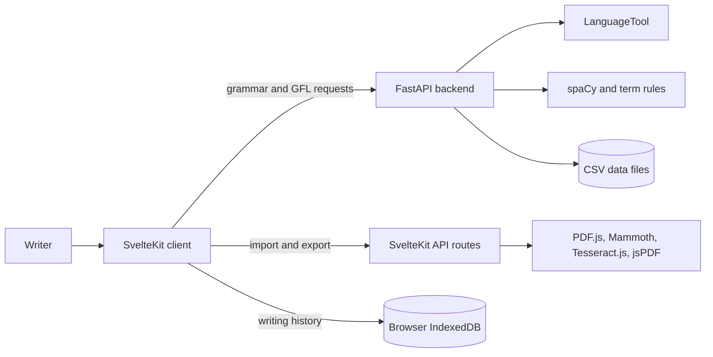

# Inkclusive

Inkclusive is a writing assistant for grammar review and gender-fair language. The project is split into two independently runnable applications:

| Application | Folder | Responsibility |
| --- | --- | --- |
| Web client | [`inkclusive-frontend/`](inkclusive-frontend/README.md) | SvelteKit interface, editor, document import/export, browser history, and admin UI |
| API server | [`inkclusive-backend/`](inkclusive-backend/README.md) | FastAPI endpoints for grammar, gender-fair suggestions, term data, and request counts |



## How the pieces fit together

1. The browser opens the SvelteKit client. Writers use `/write`, `/scan`, and `/history`; the former `/dashboard/editor`, `/dashboard/scan`, and `/dashboard/history` URLs redirect to those routes.
2. The editor uses ProseMirror. The suggestion panel sends text to the backend's versioned `/api/v1/grammar` and `/api/v1/gfl` endpoints, then displays returned suggestions so the writer can apply or ignore them.
3. The backend checks grammar with LanguageTool. Its gender-fair language logic uses spaCy, the `en_core_web_sm` model, the preferred pronouns sent by the client, and replacement rules in `gendered_terms.csv`.
4. Scan accepts PDFs, DOCX files, and JPEG/PNG images. The frontend's SvelteKit API routes extract PDF text with PDF.js, DOCX text with Mammoth, and image text with Tesseract.js. PDF and DOCX exports are handled by the frontend's export utilities and API route.
5. The current draft is autosaved in browser `localStorage`, while completed review sessions are stored in IndexedDB. The backend's analysis count and term alternatives are stored in CSV files; term guidance, categories, and examples are stored in a companion JSON file.
6. `/admin` provides a password prompt and UI for managing terms. The backend verifies the password, issues an expiring bearer token, and requires that token for all term-library endpoints. The SvelteKit server stores it in an HttpOnly cookie and proxies admin requests. Admin sign-in is rate-limited, and password changes invalidate existing tokens.

## Run locally

Start the backend first. It needs Python 3.10 or newer, the spaCy English model, and Java 17 or newer for LanguageTool's local server.

```powershell
cd inkclusive-backend
python -m venv .venv
.venv\Scripts\Activate.ps1
pip install -r requirements.txt
python -m spacy download en_core_web_sm
uvicorn main:app --reload --host 0.0.0.0 --port 8000
```

In a second terminal, configure and start the client:

```powershell
cd inkclusive-frontend
Set-Content .env 'PUBLIC_BACKEND_URL=http://localhost:8000'
npm ci
npm run dev
```

The client is served by Vite (normally `http://localhost:5173`), and the API by FastAPI at `http://localhost:8000`. Configure `PUBLIC_BACKEND_URL` for the frontend and `ADMIN_PASSWORD` plus a random `ADMIN_TOKEN_SECRET` (at least 32 bytes) for backend admin access. See the [frontend guide](inkclusive-frontend/README.md) and [backend guide](inkclusive-backend/README.md) for configuration and commands.

## Checks

From `inkclusive-frontend/`:

```sh
npm run check
npm run build
npm test
```

The frontend deploy configuration uses SvelteKit's Netlify adapter. The backend includes a Dockerfile and a Docker Compose setup.
